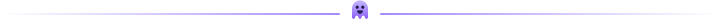

<div align="center">


<h1>GhostlyJs</h1>

<p>
  <strong>Skeleton loaders for React that measure your real UI.</strong>
  <br />
  No more hand-written skeletons.
</p>

</div>

Wrap a component in `<Ghost>`, run `ghostly measure` against your app in
dev mode, and GhostlyJs measures what is really on the screen: every text
line, image, icon, button and card, at every window width. It opens every
page and taps every button, menu and tab, so it also finds what only shows
after a tap. While your data loads, it draws a skeleton with exactly that
shape. When the design changes, measure again instead of rewriting
skeletons by hand.

```tsx
<Ghost name="profile" isLoading={isLoading}>
  <ProfileCard user={user} />
</Ghost>
```



## 📋 Requirements

| What              | Version                                                                                    |
| ----------------- | ------------------------------------------------------------------------------------------ |
| React             | 18 or newer                                                                                |
| `ghostly` CLI     | Node.js 20.12 or newer, or Bun 1.1.11 or newer                                             |
| `ghostly measure` | An installed Chrome or Edge, or a browser download (see [below](#no-chrome-or-edge-found)) |

> [!NOTE]
> Next.js, Vite and any other React setup work.


## 📦 Installation

```bash
npm install ghostlyjs
```

```bash
pnpm add ghostlyjs
```

```bash
yarn add ghostlyjs
```

```bash
bun add ghostlyjs
```


## 🚀 Quick start

### 1. Create `ghostly.json`

The measurements live in `ghostly.json` next to your `package.json`. Create
it empty, so your app can import it before anything was measured:

```bash
echo {} > ghostly.json
```

### 2. Add the provider

Wrap your app once in `<GhostlyProvider>` and pass it the measurements.

**Next.js (App Router)**: `app/layout.tsx`. The provider is a client
component, so it can sit in your server layout.

```tsx
import { GhostlyProvider } from "ghostlyjs";
import type { ReactNode } from "react";

import data from "../ghostly.json";

export default function RootLayout({ children }: { children: ReactNode }) {
  return (
    <html lang="en">
      <body>
        <GhostlyProvider data={data}>{children}</GhostlyProvider>
      </body>
    </html>
  );
}
```

**Next.js (Pages Router)**: the same around `<Component>` in
`pages/_app.tsx`.

**Vite and other setups**: around your app, e.g. in `src/main.tsx`.

```tsx
import { GhostlyProvider } from "ghostlyjs";
import { StrictMode } from "react";
import { createRoot } from "react-dom/client";

import data from "../ghostly.json";
import App from "./app";

createRoot(document.getElementById("root")!).render(
  <StrictMode>
    <GhostlyProvider data={data}>
      <App />
    </GhostlyProvider>
  </StrictMode>,
);
```

> [!TIP]
> Importing JSON needs `"resolveJsonModule": true` in your `tsconfig.json`.
> Next.js and Vite set it by default.

### 3. Wrap what loads

Wrap each part of the UI that waits for data in a `<Ghost>` with a unique
`name`:

```tsx
import { Ghost } from "ghostlyjs";

export function Profile() {
  const { user, isLoading } = useUser();

  return (
    <Ghost name="profile" isLoading={isLoading}>
      <div className="flex items-center gap-4">
        
        <div>
          <p className="font-semibold">{user?.name}</p>
          <p className="text-sm text-gray-500">{user?.role}</p>
        </div>
      </div>
    </Ghost>
  );
}
```

### 4. Measure

Start your app in **dev mode** (e.g. `npm run dev`), then run this from the
folder with your `package.json`. It writes `ghostly.json`.

```bash
npx ghostly measure http://localhost:3000
```

It opens every page of your app in a headless browser, one window per
breakpoint, and in each window:

1. **waits** until every `<Ghost>` shows its content,
2. **measures** it across the whole breakpoint, exact to the pixel. Where
   the layout changes inside a breakpoint (buttons that wrap at 390px, a
   line of text more), it stores another measurement from that width on,
3. **taps** every button, tab, menu, dialog and accordion, one after the
   other, and measures each `<Ghost>` that only shows up then. Links it
   finds, also in opened menus, are measured as pages of their own.

Each run builds `ghostly.json` anew: ghosts no page showed anymore
(renamed, deleted) are gone, and nothing old is mixed in. It only reaches
pages a link points to, so link every page, e.g. from the footer. The
routes of a hash router (`#/orders`) count as pages too.

For pages behind a login, copy your session cookie from the browser's dev
tools (Application → Cookies) and pass it with `--cookie`, the only option
of `ghostly measure` (repeat it for more cookies):

```bash
npx ghostly measure http://localhost:3000 --cookie "session=..."
```

> [!IMPORTANT]
> Tapping can't change your data: while it taps, every request that would
> write (`POST`, `PUT`, `PATCH`, `DELETE`) is blocked, so "Delete account"
> deletes nothing. Buttons and links that log out (`Log out`, `Sign out`,
> `/logout`) are never tapped or opened. To keep `ghostly measure` away
> from anything else, mark it with `data-ghostly-skip`; nothing inside it
> is tapped.

Reload the page: while `isLoading` is `true`, each `<Ghost>` shows its
skeleton.


## 🧩 Usage

### Wrapping components

```tsx
<Ghost name="order-summary" isLoading={isLoading}>
  <OrderSummary order={order} />
</Ghost>
```

- **`name`** is the key in `ghostly.json`. Use one name per piece of UI.
  Two `<Ghost>`s with the same name share one measurement, which is fine
  when they show the same thing.
- **`isLoading`**: `true` shows the skeleton, `false` the children.
- **Wrap the content itself**, not a component that renders its own
  loading state. The `<Ghost>` measures exactly what it wraps.
- **One element inside** when the `<Ghost>` sits directly in a grid or
  flex container. Its children become items of that container (a heading
  in one column, a paragraph in the next), but the skeleton is a single
  item. Wrap them in a `<div>`, and the skeleton takes their place.

> [!NOTE]
> A `<Ghost>` that was never measured shows a single placeholder bar, so the
> user still sees that something loads.

### Lists with `count`

For lists, put the `<Ghost>` **inside** the list's container and pass
`count`. Only the first item is measured, and the skeleton repeats it. The
container's grid and gap apply to the skeletons like to the real items.

```tsx
<ul className="grid gap-4 md:grid-cols-2 xl:grid-cols-3">
  <Ghost name="posts" isLoading={isLoading} count={6}>
    {posts.map((post) => (
      <li key={post.id} className="rounded-2xl border p-4">
        <h3 className="font-semibold">{post.title}</h3>
        <p className="text-gray-500">{post.excerpt}</p>
      </li>
    ))}
  </Ghost>
</ul>
```

| `count`            | Skeletons shown                                   |
| ------------------ | ------------------------------------------------- |
| `count={6}`        | Always 6.                                         |
| `count` (no value) | As many as there were items when it was measured. |
| left out           | Not a list: the whole content is one skeleton.    |

### Suspense and server components

A `<Ghost>` can be the fallback of a `<Suspense>`. Give the fallback and
the content the same `name`: the content is measured, the fallback shows
its skeleton.

```tsx
import { Ghost } from "ghostlyjs";
import { Suspense } from "react";

export default function Page() {
  return (
    <Suspense
      fallback={
        <Ghost name="profile" isLoading>
          {null}
        </Ghost>
      }
    >
      <Profile />
    </Suspense>
  );
}

async function Profile() {
  const user = await getUser();
  return (
    <Ghost name="profile" isLoading={false}>
      <ProfileCard user={user} />
    </Ghost>
  );
}
```

### Breakpoints

Layouts change with the window width, so a `<Ghost>` is measured for every
breakpoint.

The default breakpoints are Tailwind's:

| Name   | From    |
| ------ | ------- |
| `base` | 0 px    |
| `sm`   | 640 px  |
| `md`   | 768 px  |
| `lg`   | 1024 px |
| `xl`   | 1280 px |
| `2xl`  | 1536 px |

If your CSS uses other widths, pass them to the provider. The names are up
to you; below the smallest one is always `base`.

```tsx
<GhostlyProvider data={data} breakpoints={{ tablet: 700, desktop: 1100 }}>
  {children}
</GhostlyProvider>
```

> [!NOTE]
> A breakpoint that was never measured uses the next smaller measured one.
> After changing the breakpoints, measure again.

Inside a breakpoint, `ghostly measure` sees how the content follows the
window: a column that grows, a button pushed to the right edge, a chart
that keeps its aspect ratio. The skeleton follows it the same way (with
`calc()` and container units), so it matches at every width, not only at
the breakpoint. Where the layout changes inside a breakpoint, like buttons
that wrap, `ghostly.json` gets another entry from that width on, e.g.
`"base@390"`.

### Content behind a tap with `isMeasuring()`

`ghostly measure` taps everything to reach content that only shows after a
tap. If that's not enough (it needs typing, or a tap would be blocked as a
write), show the content right away while measuring. `isMeasuring()` is
`true` only in the browser of `ghostly measure`; check it in an effect,
since the server doesn't know:

```tsx
import { isMeasuring } from "ghostlyjs";

useEffect(() => {
  if (isMeasuring()) setShowResults(true);
}, []);
```

### Types

```ts
import type { GhostProps, GhostlyProviderProps } from "ghostlyjs";
import type { Breakpoints, GhostlyData } from "ghostlyjs/core";
```


## 🎨 Styling

The skeletons use your text color at 10% opacity, so they fit light and
dark mode without configuration. To change their look, style these classes
in your own CSS:

| Class                  | Element                                             |
| ---------------------- | --------------------------------------------------- |
| `.ghostly-skeleton`    | The frame of one skeleton. Pulses.                  |
| `.ghostly-box`         | One shape inside it: a text line, an image, a card. |
| `.ghostly-placeholder` | The bar of a `<Ghost>` never measured.              |

```css
.ghostly-box,
.ghostly-placeholder {
  background-color: rgb(148 163 184 / 0.2);
}
```

> [!NOTE]
> The pulse is turned off when the user prefers reduced motion.


## 🩺 Troubleshooting

#### A `<Ghost>` shows a single grey bar

It was never measured. Run `ghostly measure`. If it reports that the
`<Ghost>` never showed its content, it loads too slowly (no request runs
and nothing on the page changes for 3 seconds), sits on a page no link
points to (link it, e.g. from the footer), or needs more than taps (use
[`isMeasuring()`](#content-behind-a-tap-with-ismeasuring)).

#### A tap does something it shouldn't, or misses something

Run `GHOSTLY_DEBUG=1 npx ghostly measure <url>` to see every tap, per
page and window width. Mark elements it should leave alone with
`data-ghostly-skip`.

#### "`ghostly dev` was removed"

Since 0.3.0, `ghostly measure` taps every button itself and reaches what
`ghostly dev` was needed for. Run `ghostly measure` once to measure
everything the new way.

#### "This is a production build"

`<Ghost>` only measures in dev mode. Point `ghostly measure` at your dev
server (`npm run dev`), not at `npm run build && npm start`.

#### "No Chrome or Edge found"

`ghostly measure` uses your installed Chrome or Edge. Without one, download
a browser for it once (about 200 MB):

```bash
npx playwright-core install chromium-headless-shell
```

#### `ghostly.json` has a merge conflict

Your app can't import it then. Run `ghostly measure` again: it replaces
the file.

#### The skeleton doesn't match after a design change

Measure again. `ghostly.json` only knows the layout from when it was
measured.


## 📄 License

[MIT](https://github.com/justintischendorf/ghostlyjs/blob/main/LICENSE)
